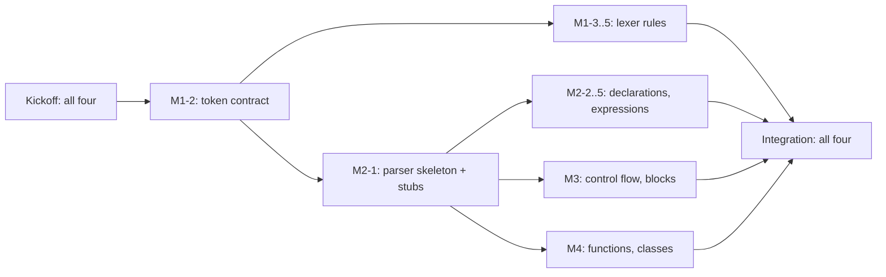

# CMPN403: Phase I Work Division (4 Members)

**Deliverable:** the Lex and Yacc files, i.e. a working lexer and parser. **Due:** week 11.

## 1. Scope

| In Phase I | Not in Phase I (Phase II) |
|---|---|
| Language design, `lexer.l`, `parser.y` | Symbol table |
| Every required construct, including classes and objects | Quadruples |
| Accept valid programs; report the first syntax error with its line | Full syntax error handler (recovery, multiple errors) |
| Constructors (optional, bonus) | Semantic analyzer, type conversion, GUI |

The test suite, the basic error message and the document drafts below are not explicitly required for Phase I. They are included because they prove the parser works and are reused in Phase II.

## 2. Who does what

| Member | Role | Main output | Points |
|---|---|---|---|
| **M1** | Lexer and tooling | `lexer.l`, `main.c`, `Makefile`, test runner | 22 |
| **M2** | Parser core: declarations, expressions, assignment | `parser.y` skeleton and sections A, B | 22 |
| **M3** | Control flow and blocks | `parser.y` section C | 22 |
| **M4** | Functions, classes and objects | `parser.y` section D | 22 |

Points are estimated effort (1 point is about 1 hour). The itemized steps in section 5 add up to 22 for each member.

## 3. Dependencies



| Who waits | On whom | For what | Type |
|---|---|---|---|
| M2 | M1 | Token names in `parser.y` (step M1-2) | **Hard** |
| M3, M4 | M2 | Skeleton with stubs (step M2-1) | **Hard** |
| M2, M3, M4 | M1 | Working lexer, to run test programs (M1-3 to M1-5) | Soft: `bison` can check grammar without it |
| M3 | M2 | Real `expr`, `decl`, `assignment` | Soft: M2-1 provides early versions |
| M3 | M4 | Real `call` (used as a statement) | Soft: stub exists |
| M4 | M3 | Real `block` (function and method bodies) | Soft: stub exists |
| M2 | M4 | Real `postfix` (used by `expr` and `lvalue`) | Soft: stub exists |
| M4 | M2 | Real `type`, `decl`, `expr` | Soft: M2-1 provides early versions |
| M1 | M2, M3, M4 | Their test files, for the final test run | Final only |

**Critical path:** kickoff → M1-2 → M2-1 → sections C and D → integration. M1-2 and M2-1 are the only steps that fully block someone, so both must be finished by the end of Day 2.

## 4. Shared contract (agree at kickoff, then freeze)

Changing anything here requires telling all four members.

### 4.1 Language decisions

| Topic | Decision |
|---|---|
| Types | `int`, `float`, `bool`, `char`, `string`, class names; `void` for functions only |
| Blocks | `{ declarations first, then statements }`; braces are mandatory on all control bodies (no dangling `else`) |
| Objects | `Point p = new Point(1, 2);` |
| Switch | `case` takes a constant; optional `default` comes last; declarations inside a case need braces |
| Repeat | `repeat { ... } until (cond);` |
| Top level | Declarations, statements, functions and classes in any order |

### 4.2 Tokens

- **Keywords** (`KW_` prefix avoids clashes with Windows macros such as `INT` and `BOOL`): `KW_INT KW_FLOAT KW_BOOL KW_CHAR KW_STRING KW_VOID KW_CONST KW_IF KW_ELSE KW_WHILE KW_REPEAT KW_UNTIL KW_FOR KW_SWITCH KW_CASE KW_DEFAULT KW_BREAK KW_CONTINUE KW_RETURN KW_CLASS KW_NEW KW_THIS`
- **Values:** `IDENT INT_LIT FLOAT_LIT CHAR_LIT STRING_LIT BOOL_LIT`
- **Multi-character operators:** `EQ NE LE GE AND OR`
- **Single characters**, returned as themselves: `+ - * / % < > ! = ( ) { } ; , : .`

### 4.3 Nonterminal ownership (one owner each; nobody else edits that rule)

| Section | Owner | Nonterminals |
|---|---|---|
| A. Core | M2 | `program top_item type prim_type decl` |
| B. Expressions | M2 | `expr literal assignment lvalue` |
| C. Control flow | M3 | `statement block decls stmts if_stmt while_stmt repeat_stmt for_stmt for_init switch_stmt cases case case_const case_body default_opt` |
| D. Functions and classes | M4 | `func_def params_opt params param call args_opt args postfix class_def members_opt member ctor_def` |

### 4.4 Git rules

1. One branch per member; edit only your own section of `parser.y`.
2. Merge by pull request with one reviewer (pairs: M1 ↔ M2, M3 ↔ M4).
3. A PR merges only if `bison` reports **0 conflicts** and all tests pass. Never silence conflicts with `%expect`.

## 5. Steps per member

### M1: Lexer and tooling

| Step | Task | Pts | Needs |
|---|---|---|---|
| M1-1 | Create the repo, folder layout and `Makefile` (`bison -d`, `flex`, `gcc`; targets `all`, `test`, `clean`) | 2 | Kickoff |
| M1-2 | Write the `%token` list, `%union` and `%locations` at the top of `parser.y`. **Push this first; M2 is waiting** | 2 | Kickoff |
| M1-3 | Lex rules for keywords, identifiers and operators. Keywords go before identifiers | 3 | M1-2 |
| M1-4 | Literals: int, float, bool, char and string with escapes. Numbers are unsigned (`-` belongs to the parser). `strdup` text into `yylval` | 3 | M1-2 |
| M1-5 | Skip whitespace, `//` and `/* */` comments; keep line and column up to date | 2 | M1-3 |
| M1-6 | Lexical errors: illegal character, unterminated string, char or comment, each with its line | 2 | M1-5 |
| M1-7 | `main.c`: open the file from `argv[1]`, call `yyparse()`, print the result, return 0 or 1; add a `--tokens` mode | 2 | M1-2; linking needs M2-1 |
| M1-8 | `make test` script: everything in `tests/valid` must pass, everything in `tests/invalid` must fail. Add lexer tests | 2 | M1-7 |
| M1-9 | Write the token list with descriptions, including class-related tokens, plus tools used | 2 | M1-6 |
| M1-10 | Integration: clean-clone build on a second machine; package the submission | 2 | All |

**Done when:** `--tokens` prints the right stream for every construct, and a clean clone builds with one `make`.

### M2: Parser core, declarations and expressions

| Step | Task | Pts | Needs |
|---|---|---|---|
| M2-1 | `parser.y` skeleton: section banners, `program`, `top_item`, early `type`/`decl`/`expr`/`assignment`, and stubs for C and D (section 6). **Push this first; M3 and M4 are waiting** | 3 | M1-2 |
| M2-2 | Finish `type` and `decl`: variable, initialized variable, constant (initializer required), object type via `IDENT` | 3 | M2-1 |
| M2-3 | Precedence table and `expr`: arithmetic, relational, logical, unary minus (`%prec UMINUS`) and `!` | 4 | M2-1 |
| M2-4 | `literal` | 1 | M2-1 |
| M2-5 | `assignment` and `lvalue` (`x = ...`, `obj.attr = ...`) | 2 | M2-1; testing `obj.attr` needs M4-4 |
| M2-6 | `yyerror`: `Syntax error at line L, column C: ...` with `%define parse.error verbose` | 2 | M2-1 |
| M2-7 | Tests: at least 6 valid and 4 invalid | 3 | M1-8 |
| M2-8 | Document overview, declaration and expression syntax, precedence table | 2 | M2-5 |
| M2-9 | Integration: merge owner for `parser.y`; resolve conflicts between sections | 2 | All |

**Done when:** `const float k = -(a + b) * 2.5 / c;` and `x = a < b && !(c == d);` are accepted, and `const int x;` and `x = + ;` are rejected.

### M3: Control flow and blocks

| Step | Task | Pts | Needs |
|---|---|---|---|
| M3-1 | `block`, `decls`, `stmts`, with nesting. Use the four-alternative form in section 6 | 3 | M2-1 |
| M3-2 | `statement`: all alternatives, including `break`, `continue`, `return` and `return expr` | 3 | M2-1 |
| M3-3 | `if_stmt`: `if`, `if-else`, `else if` chains | 2 | M3-1 |
| M3-4 | `while_stmt` and `repeat_stmt` | 2 | M3-1 |
| M3-5 | `for_stmt` and `for_init` (declaration or assignment; assignment as the step) | 2 | M3-1 |
| M3-6 | `switch_stmt`: cases, constants, optional `default`, fall-through, empty bodies | 4 | M3-2 |
| M3-7 | Tests: at least 6 valid (including 3-level nesting) and 4 invalid | 3 | M1-8 |
| M3-8 | Document control-flow and block syntax | 1 | M3-6 |
| M3-9 | Integration: audit `bison -v` output for conflicts and unused rules; write one program using every control structure | 2 | All |

**Done when:** every structure parses when nested in every other, and a declaration after a statement in a block, or a missing `until`, is rejected.

### M4: Functions, classes and objects

| Step | Task | Pts | Needs |
|---|---|---|---|
| M4-1 | `func_def`, `params_opt`, `params`, `param` (typed and `void`) | 3 | M2-1 |
| M4-2 | `args_opt`, `args` | 1 | M2-1 |
| M4-3 | `call`: `f(a, b)` and `obj.method(a)` | 2 | M4-2 |
| M4-4 | `postfix`: identifier, `this`, `new C(...)`, parentheses, chained access `a.b.c().d` | 4 | M4-3 |
| M4-5 | `class_def`, `members_opt`, `member`: attributes and methods | 3 | M4-1 |
| M4-6 | `ctor_def` (bonus) | 1 | M4-5 |
| M4-7 | Tests: at least 6 valid and 4 invalid | 3 | M1-8 |
| M4-8 | Document class and object syntax: declaration, attributes, methods, instantiation, member access | 3 | M4-6 |
| M4-9 | Integration: write the full demo program (class, objects, functions and loops together) | 2 | All |

**Done when:** the demo below parses, and `class { }`, `p.;` and `f(1,);` are rejected.

```
class Point {
    int x;
    int y;
    Point(int a, int b) { this.x = a; this.y = b; }
    int sum() { return this.x + this.y; }
}
Point p = new Point(1, 2);
p.x = 5;
int s = p.sum();
```

## 6. Grammar traps

1. **Blocks (M3).** Do not write `'{' decls stmts '}'` with lists that can be empty. An `IDENT` may start a declaration (`Point p;`) or a statement (`p = 1;`), so Yacc gets shift/reduce conflicts. Use non-empty lists:

   ```yacc
   block : '{' '}' | '{' decls '}' | '{' stmts '}' | '{' decls stmts '}' ;
   decls : decl      | decls decl ;
   stmts : statement | stmts statement ;
   ```

2. **Member access (M2, M4).** Keep `lvalue` and `postfix` separate, and make calls reachable from `expr` only through `postfix`:

   ```yacc
   lvalue  : IDENT | postfix '.' IDENT ;
   call    : IDENT '(' args_opt ')' | postfix '.' IDENT '(' args_opt ')' ;
   postfix : IDENT | KW_THIS | call | postfix '.' IDENT
           | KW_NEW IDENT '(' args_opt ')' | '(' expr ')' ;
   ```

3. **Stubs (M2-1).** Bison errors on a used nonterminal with no rule, so each stub needs a placeholder: `if_stmt : KW_IF ;` (same pattern for `while_stmt`, `repeat_stmt`, `for_stmt`, `switch_stmt`, `class_def`), `block : '{' '}' ;`, `func_def : KW_VOID IDENT '(' ')' block ;`, `call : IDENT '(' ')' ;`, `postfix : IDENT | call ;`.

4. **Leave to Phase II.** `break` outside a loop, `return` outside a function, `this` outside a class and assigning to a constant are semantic errors. The Phase I grammar accepts them on purpose.

A draft grammar with these rules was run through Bison: the full grammar and the stubbed skeleton both give 0 conflicts. It was not run together with a lexer.

## 7. Schedule

| Day | M1 | M2 | M3 | M4 |
|---|---|---|---|---|
| 1 | Kickoff, **M1-2**, M1-1 | Kickoff | Kickoff, draft section C on paper | Kickoff, draft section D on paper |
| 2 | M1-3, M1-4 | **M2-1** | Write invalid test programs | Write invalid test programs |
| 3-4 | M1-5 to M1-7 | M2-2 to M2-4 | M3-1 to M3-4 | M4-1 to M4-4 |
| 5 | M1-8 | M2-5, M2-6 | M3-5, M3-6 | M4-5, M4-6 |
| 6 | M1-9 | M2-7, M2-8 | M3-7, M3-8 | M4-7, M4-8 |
| 7 | M1-10 | M2-9 | M3-9 | M4-9 |

Day 7 should land at least two days before the week 11 deadline.

## 8. Phase I completion checklist

- [ ] `make` on a clean clone succeeds with 0 Bison conflicts
- [ ] All tests in `tests/valid` pass and all in `tests/invalid` fail with a line number
- [ ] Every construct in the project document has a valid and an invalid test
- [ ] Every member can explain every section of `parser.y`
- [ ] `lexer.l` and `parser.y` submitted
